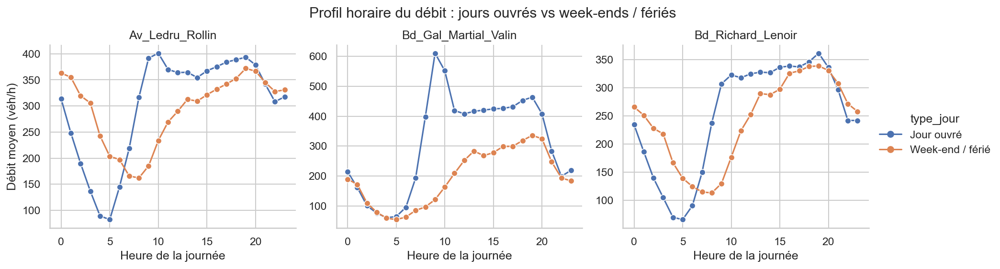
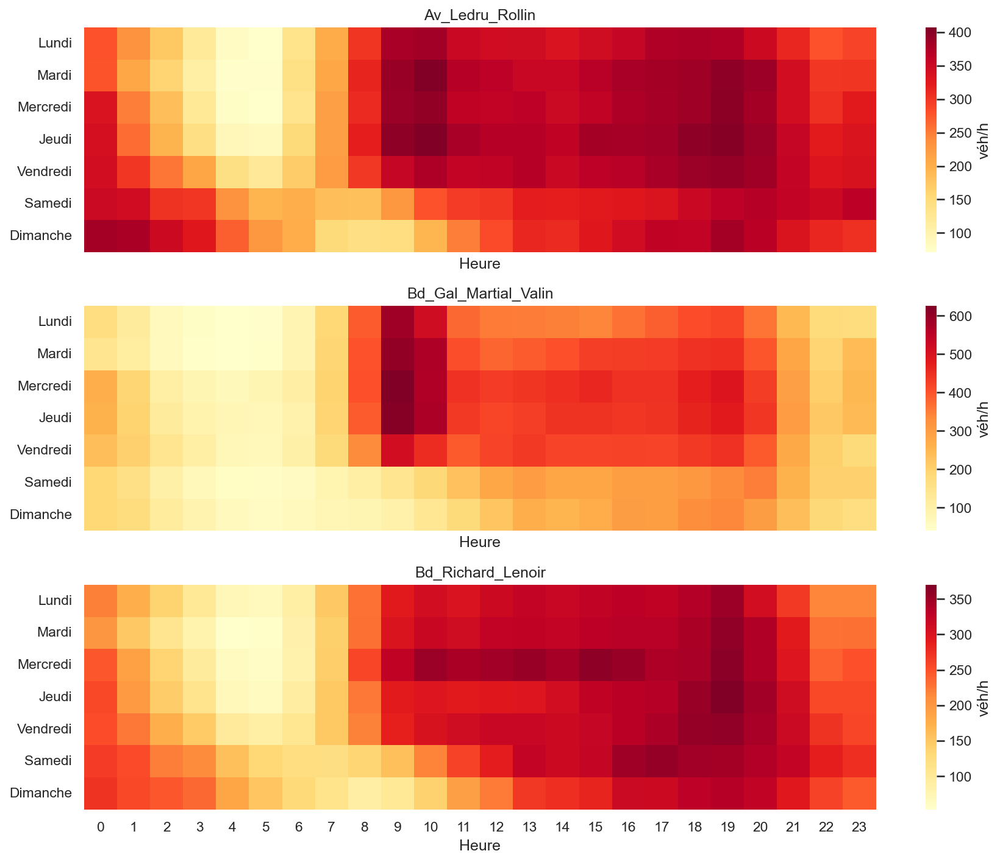

# Trafic routier à Paris : Bd Richard-Lenoir, Av. Ledru-Rollin, Bd Général Martial-Valin

> Projet réalisé dans le cadre du module « Analyse et Transformation de Données » (MSc DM2, octobre 2026). Exercice d'entraînement.

## La question
Comment le trafic évolue-t-il selon l'heure et le jour (semaine / week-end) sur trois axes parisiens, de mars à août 2026, et que montrent les capteurs sur la congestion et l'effet des vacances d'été ?

## Les données
- **Source :** [Comptages routiers permanents](https://opendata.paris.fr/explore/dataset/comptages-routiers-permanents/), Ville de Paris (boucles électromagnétiques, mesure horaire).
- **Axes :** `Bd_Richard_Lenoir` (10 tronçons), `Av_Ledru_Rollin` (8), `Bd_Gal_Martial_Valin` (6) ; 24 tronçons au total.
- **Période :** 1er mars – 31 août 2026, soit environ 106 000 lignes (≈ 12 Mo).
- **Pièges rencontrés :** CSV séparé par `;` avec BOM ; dates avec décalage horaire (changement d'heure du 29 mars) ; doublons ; valeurs manquantes plus fréquentes pour l'occupation que pour le débit ; `Inconnu` qui est une absence de mesure ; tronçons `Barré` / `Invalide` ; valeurs extrêmes de débit. Détail et chiffres dans `02_types_et_nettoyage.ipynb`.

## Résultats
>1. Heure de pointe en semaine : 10 h sur Av. Ledru-Rollin (401 véh/h), 9 h sur Bd Gal Martial-Valin (611 véh/h), 19 h sur Bd Richard-Lenoir (362 véh/h).
2. Le trafic du week-end est 37 % plus bas qu'en semaine sur Martial-Valin, mais seulement 3 à 4 % plus bas sur Ledru-Rollin et Richard-Lenoir.
3. En août, le débit moyen est inférieur à celui de juin de 24 % (Ledru-Rollin), 51 % (Martial-Valin) et 21 % (Richard-Lenoir).
4. L'occupation dépasse 30 % sur 1,5 % des heures sur Ledru-Rollin et presque jamais sur les deux autres.




## Limites
- Un tronçon n'est pas représentatif de tout l'axe ; les capteurs comptent des véhicules, pas des personnes.
- Six mois seulement : pas de saisonnalité annuelle ; ponts et grèves non traités.
- Les valeurs manquantes ne sont pas aléatoires (capteurs en panne) ; pas d'imputation, les moyennes ignorent ces heures.
- Pas de météo ni d'événements : on décrit, on n'explique pas.

## Lancer le projet
```bash
pip install -r requirements.txt
python download_data.py
```
Puis exécuter les notebooks dans l'ordre : `01_…`, `02_…`, `03_…`, `04_…` (chacun s'exécute de haut en bas).

## Utilisation de l'IA
- **Outil :** Claude (Anthropic).
- **Pour quoi faire :** structurer le projet et rédiger une première version des notebooks 
- **Vérification :** le code a été testé sur des données simulées au même format ; les résultats chiffrés doivent venir de l'exécution sur les données réelles.